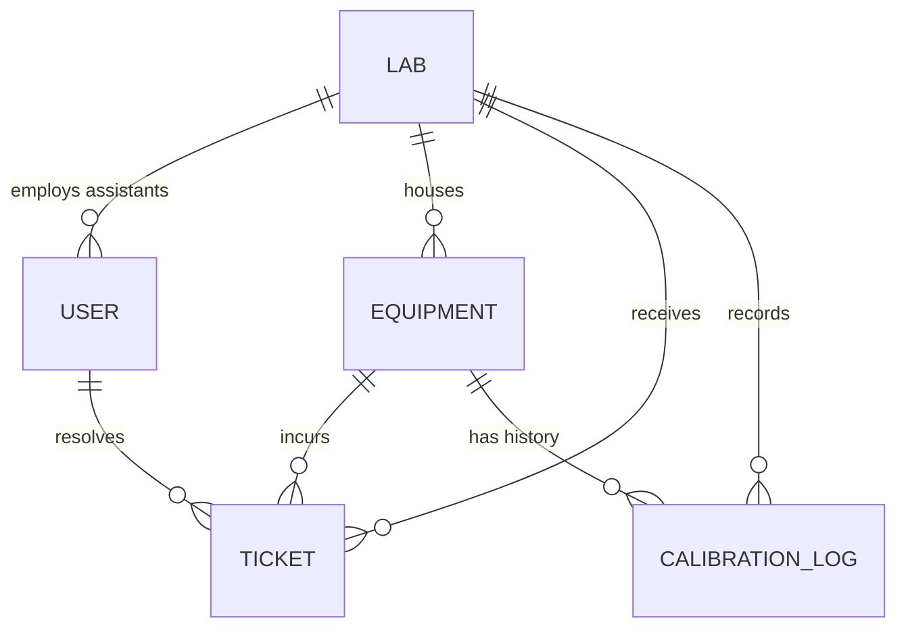

# Phase 1: MongoDB Schema Blueprint & Relationships

This document outlines the 5 core MongoDB collections using Mongoose ORM, enforcing strict business logic, relationship constraints, immutability, and soft deletion.

---

## 1. Core Principles
1. **Three Independent Statuses**:
   - `Operational Status`: `Ready to Use` | `Under Repair` | `Damaged`
   - `Calibration Status`: `Valid` | `Due Soon` | `Overdue` (Dynamically evaluated or tracked based on dates)
   - `Ticket Status`: `Open` | `Under Review` | `In Repair` | `Resolved`
2. **Damage Count**:
   - Starts at `0`.
   - Increments by `1` on valid new fault ticket submission.
   - Never resets or decrements, even after ticket resolution.
3. **Soft Deletion**:
   - Records are never permanently removed (`deleteOne()`).
   - `isActive: { type: Boolean, default: true }` marks active/archived state.
4. **Historical Immutability**:
   - Every completed calibration logs a permanent record in `calibrationLogs`.
   - Resolved tickets remain permanently in `tickets` for audit readiness.

---

## 2. Collections Specification

### 1. `users` Collection
Stores administrative and lab assistant credentials and lab assignments.
```javascript
{
  _id: ObjectId,
  name: { type: String, required: true, trim: true },
  email: { type: String, required: true, unique: true, lowercase: true, trim: true },
  mobile: { type: String, required: true, trim: true },
  passwordHash: { type: String, required: false }, // Set via invite link for Assistants
  role: { type: String, enum: ['Admin', 'Assistant'], required: true },
  assignedLabId: { 
    type: mongoose.Schema.Types.ObjectId, 
    ref: 'Lab', 
    required: function() { return this.role === 'Assistant'; } 
  },
  setupToken: { type: String }, // Hashed token for initial password setup via Nodemailer
  setupTokenExpires: { type: Date },
  isActive: { type: Boolean, default: true },
  createdAt: { type: Date, default: Date.now },
  updatedAt: { type: Date, default: Date.now }
}
```

### 2. `labs` Collection
Stores physical laboratory units.
```javascript
{
  _id: ObjectId,
  labId: { type: String, required: true, unique: true, uppercase: true, trim: true }, // e.g. "LAB-A8F21"
  labName: { type: String, required: true, trim: true }, // e.g. "Chemistry Lab 1"
  labBlock: { type: String, required: true, trim: true }, // e.g. "Block A"
  isActive: { type: Boolean, default: true },
  createdAt: { type: Date, default: Date.now },
  updatedAt: { type: Date, default: Date.now }
}
```

### 3. `equipment` Collection
Stores registered instruments, operational condition, and calibration dates.
```javascript
{
  _id: ObjectId,
  publicId: { type: String, required: true, unique: true, index: true }, // Stable nanoid/UUID for QR URL
  labId: { type: mongoose.Schema.Types.ObjectId, ref: 'Lab', required: true, index: true },
  name: { type: String, required: true, trim: true }, // e.g. "Digital Storage Oscilloscope"
  serialNumber: { type: String, required: true, trim: true },
  model: { type: String, trim: true },
  location: { type: String, required: true, trim: true }, // e.g. "Bench 04, Room 201"
  installationDate: { type: Date },
  operationalStatus: { 
    type: String, 
    enum: ['Ready to Use', 'Under Repair', 'Damaged'], 
    default: 'Ready to Use' 
  },
  damageCount: { type: Number, default: 0, min: 0 },
  calibrationIntervalDays: { type: Number, default: 180 }, // Days between calibrations
  lastCalibrationDate: { type: Date, default: Date.now },
  nextCalibrationDate: { type: Date, required: true, index: true },
  isActive: { type: Boolean, default: true },
  createdAt: { type: Date, default: Date.now },
  updatedAt: { type: Date, default: Date.now }
}
```

### 4. `tickets` Collection
Stores fault tickets submitted by students and tracked by lab assistants.
```javascript
{
  _id: ObjectId,
  ticketId: { type: String, required: true, unique: true }, // e.g. "TKT-20261107-101"
  equipmentId: { type: mongoose.Schema.Types.ObjectId, ref: 'Equipment', required: true, index: true },
  labId: { type: mongoose.Schema.Types.ObjectId, ref: 'Lab', required: true, index: true },
  studentName: { type: String, required: true, trim: true },
  rollNumber: { type: String, required: true, uppercase: true, trim: true },
  mobile: { type: String, required: true, trim: true },
  email: { type: String, trim: true, lowercase: true },
  description: { type: String, required: true, trim: true },
  photoUrl: { type: String, required: true }, // Cloudinary URL
  ticketStatus: { 
    type: String, 
    enum: ['Open', 'Under Review', 'In Repair', 'Resolved'], 
    default: 'Open',
    index: true
  },
  resolutionNotes: { type: String, trim: true },
  resolvedAt: { type: Date },
  resolvedBy: { type: mongoose.Schema.Types.ObjectId, ref: 'User' },
  createdAt: { type: Date, default: Date.now },
  updatedAt: { type: Date, default: Date.now }
}
```

### 5. `calibrationLogs` Collection
Permanent historical ledger of completed calibration activities.
```javascript
{
  _id: ObjectId,
  equipmentId: { type: mongoose.Schema.Types.ObjectId, ref: 'Equipment', required: true, index: true },
  labId: { type: mongoose.Schema.Types.ObjectId, ref: 'Lab', required: true, index: true },
  calibratedBy: { type: String, required: true, trim: true }, // Technician/Agency name
  calibrationDate: { type: Date, required: true },
  nextDueDate: { type: Date, required: true },
  certificateUrl: { type: String }, // Optional Cloudinary PDF/Image link
  remarks: { type: String, trim: true },
  createdAt: { type: Date, default: Date.now }
}
```

---

## 3. Entity Relationships Diagram (Mermaid)


